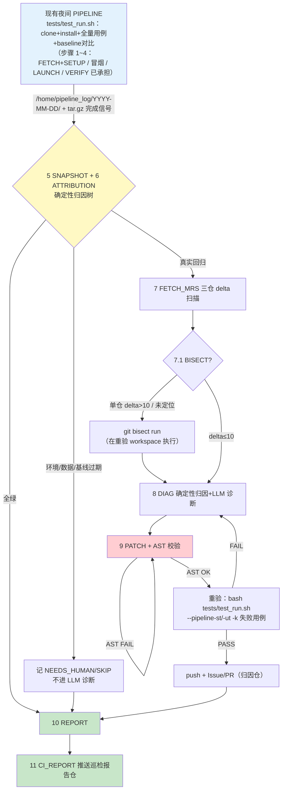

# MindSpeed-LLM 夜间巡检（llm-nightly-sync）

## 背景

MindSpeed-LLM 及其依赖形成一条 **下游套件 → 滚动上游 → 固定底座** 的依赖链：

```text
MindSpeed-LLM (master, 巡检主体)
  ├─→ MindSpeed (master, 每日滚动)     ← 最主要破坏源（features_manager 算子/特性持续演进）
  ├─→ FSDPTurbo (main, 滚动)           ← fsdp2 系用例的破坏源
  ├─→ Megatron-LM (core_v0.12.1 固定)  ← 不滚动；仅 submodule tag 升级时验证
  └─→ torch_npu 2.7.1 → CANN → 910B3/A3 ← 环境基座
```

| 仓 | 定位 | 在巡检中的角色 |
|---|---|---|
| **mindspeed_llm** | 大模型分布式训练套件 | 巡检主体；`tests/pipeline` 每夜全量用例 |
| **mindspeed** | 训练加速库（core） | 每日 master 滚动，delta 归因第一嫌疑 |
| **fsdpturbo** | FSDP2 加速库 | 每日 main 滚动，影响 fsdp2 用例 |
| **megatron_lm** | NVIDIA 训练框架 | 固定 tag `core_v0.12.1`，日常 delta=0 |

**核心冲突**：MindSpeed / FSDPTurbo 每日更新不考虑 LLM 兼容性；LLM 自身 master 每日合入 PR 也可能引入回归。仓库**已有**每天夜间的 PIPELINE（`tests/pipeline/`，`tests/test_run.sh` 拉起，次日输出测试报告），但它只「跑用例 + baseline 对比 + 打日志包」，失败后要人工看报告排查——不知道当天上游动了什么、不知道该找哪个仓、没有修复闭环。

**因此巡检的目标是**：在现有夜间 PIPELINE 之上补齐「上游 commit 快照 + delta 归因 + LLM 诊断修复 + Issue/PR 闭环 + 飞轮」，保障每天都有一个配套最新上游、全量 pipeline 用例可用的 MindSpeed-LLM。

## 巡检设计总览

巡检不重复造执行层，围绕五个环节构建「检测 → 归因 → 修复 → 闭环 → 沉淀」的完整链路：

| 环节 | 设计 |
|---|---|
| 用例执行 | 消费现有夜间 PIPELINE 产物（clone + install + 全量用例 + baseline 对比），不重复烧卡 |
| delta 计算 | 3 滚动仓独立 last_good（LLM/MindSpeed/FSDPTurbo），MLM 固定 tag 不参与；各仓 `last_good → target` 的 commit 集合即本次变更 delta，按仓独立计算 |
| 失败检测 | 复用 `test_ci_st.py` 五项 baseline 对比（loss/grad_norm/throughput/time/memory）+ 用例退出码 |
| 归因 | 确定性归因树先于 LLM：三仓 delta × 用例特征双轴，先拦下环境/数据/基线过期三类「假回归」，仅真实回归进入 LLM 诊断 |
| 飞轮 | 全绿 → last_good 前移 → delta 窗口更小；失败 → 案例入库 → 同类失败秒级命中；baseline 过期走独立刷新流程（LLM 特有的一类「假失败」） |

## 环境要求

- 巡检与现有 PIPELINE **同机部署**（或可读其 `/home/pipeline_log` 的共享存储），直接复用其产物与数据
- Python 环境与 pipeline 对齐：**执行容器内 conda env（torch 2.x/torch_npu 所在）+ CANN**；容器名/conda 环境名/conda 根默认为 `llm_ci_q4` / `llm_test` / `/root/miniconda3`，可经 deploy 向导①②③项或环境变量 `DOCKER` / `CONDA_ENV` / `CONDA_HOME` 按部署实际设置，经 cron 行 `docker exec -e` 传导到 orchestrator；cron 非交互不读 .bashrc，orchestrator 已内置显式加载（conda activate + CANN set_env）
- 共享数据资源 `/data/ci`（权重/数据集）已在位并按 `tests/resource_record.md` 登记——重验用例直接复用
- gitcode 凭据（用户名+令牌）与 CI fork 闭环仓：deploy 向导⑧或手动填 `.push_config.json`（`repos.<key>.ci_fork_url` 配置后走 CI fork 闭环：每次先同步上游 base 到 fork，分支 `ci_repair_<YYMMDD>`，Issue/PR 均提 CI fork；未配则降级本地 commit + NEEDS_HUMAN）
- agent 运行环境（Step2 诊断）：Claude Code 经 `setup-cc-ds.sh` 国内镜像安装、API 走智谱 **GLM Coding Plan** 的 Anthropic 兼容端点（`open.bigmodel.cn/api/anthropic`，国内可达；DeepSeek 端点作备选可两行切换）；**cron 为非交互 shell 不加载 `~/.bashrc`**，token 等变量固化在 `scripts/.cc_env`（`gen_cc_env.sh` 生成，权限 600、gitignore 排除），由 orchestrator 启动时显式 source，并补全 PATH（cron 默认不含 /usr/local/bin）
- 重验 workspace：`/home/llm_nightly/workspace/` 下按 `repo_matrix.json` 维护四仓 clone（MLM checkout 固定 tag，其余跟远端）

## 输入

Skill 启动时问用户两个问题（不回答则全自动）：

**问题 1**：各仓上一次全绿的 commit 是？

- A：用户逐仓输入；B 默认：读 `state/last_good.json`（飞轮记录），无记录则取昨天 0 点后各仓第一个 commit

**问题 2**：待验证的目标 commit 是？

- A：用户输入；B 默认：当日 PIPELINE 实际使用的各仓 commit（SNAPSHOT 阶段记录）

各仓 `last_good → target` 之间的 commit 集合即本次关注的变更 delta，**按仓独立计算**。

## 核心逻辑

**上一次全绿的组合 → 当天组合有失败 → delta = 可能引入问题的 commit（按仓归属）。**

失败后获取对应仓的 delta MR diff + 失败日志，先走确定性归因树（环境/数据/基线过期/真实回归），仅真实回归进入 LLM 诊断：搜索空间从整个代码库压缩到「24 小时内的几十个 commit + 单用例日志」。诊断产出修复 → AST/门禁校验 → 只重验失败用例（`test_run.sh -k`）→ Issue/PR 闭环。

**飞轮**：全绿 → 各仓 last_good 前移 → delta 窗口更小；失败 → 案例入库 → 下次同类失败秒级命中。飞轮每转一圈，系统就更聪明一点。

## Pipeline



步骤 1~4 由现有夜间 PIPELINE 承担，本 skill 实现 5~11。

### 步骤总览

| 步骤 | 承担者 | 脚本/产物 | 失败去向 |
|---|---|---|---|
| 1~4 | 现有 PIPELINE | `tests/test_run.sh` + `tests/test_tools/*` | 产物落 `/home/pipeline_log/<date>/` |
| 5 SNAPSHOT | 巡检 | `nightly_postprocess.py` → `env_report.json`（三仓 commit 快照） | — |
| 6 ATTRIBUTION | 巡检 | `attribution_report.json`（确定性归因） | 环境类→NEEDS_HUMAN；回归→7 |
| 7 FETCH_MRS | 巡检 | `fetch_mrs.py` → `diff_report.json`（按仓 delta + LLM 调用点交叉比对） | → 7.1 或 8 |
| 7.1 BISECT | 巡检 | `bisect_report.json` | → 8 |
| 8 DIAG | 巡检+LLM | `diag_report.json`（breaking_mrs/root_cause/fix_repo） | → 9 |
| 9 PATCH | 巡检+LLM | 修复代码 + AST 校验 + 重验 | 重验→8（≤3 轮）→NEEDS_HUMAN |
| 10 REPORT | 巡检 | `final_report.json` + 追加飞轮 | — |
| 11 CI_REPORT | 巡检 | 推送巡检报告仓 `sync_build_results/YYYY-MM/MM-DD/` | — |

### 5 SNAPSHOT——commit 快照（LLM 特有的后置快照）

现有 PIPELINE 的 `test_run.sh` 开头 clone 各仓但不记录 commit。巡检采用**后置快照**：postprocess 在 PIPELINE 完成信号（当日 `*.tar.gz` 生成）后立即 `git ls-remote` 取三仓当前 HEAD——凌晨拉起与巡检读数之间的误差仅为 PIPELINE 运行时长内的少量推送，可接受；postprocess 已支持优先读取 `commits.txt`，`test_run.sh` 后续记录各仓 commit 后自动切换为精确快照。

### 6 ATTRIBUTION——确定性归因树（先于 LLM）

一眼能看出来的问题先让程序判，不浪费大模型：

1. 日志含 `FileNotFoundError` / `No such file or directory` 且路径在 `/data/ci` → **DATA**（共享数据资源缺失，NEEDS_HUMAN，不诊断）
2. `hcclCommInitRootInfoConfig` / `EI0020` / HCCL 端口占用 → **ENV**（他租户占用或环境故障，SKIP 该日）
3. **零 delta**（三仓 commit 均未变）却失败 → **BASELINE_DRIFT / FLAKY**：性能类指标（throughput/time 超 5% margin）优先判 baseline 过期 → 走刷新流程；loss/退出码类偶发 → 重跑一次定 FLAKY
4. delta 仅 `mindspeed_llm` → **fix_repo=mindspeed_llm**（当天合入 PR 的回归）
5. delta 仅 `mindspeed` → **fix_repo=mindspeed**（MindSpeed 算子/特性破坏 LLM；修复落归因仓）
6. delta 仅 `fsdpturbo` 且失败用例全为 fsdp2 系（`*_fsdp2*` / `train_fsdp2`）→ **fix_repo=fsdpturbo**
7. 多仓同时有 delta → 用例特征细分：仅 fsdp2 用例挂→FSDPTurbo 先验；全量/绝大多数挂→MindSpeed 或环境先验；单模型单用例挂→LLM 自身该模型模块先验；仍不明确→进入 8 由 LLM 结合 diff 判断

### 7 FETCH_MRS——按仓 delta 扫描

对每个有 delta 的仓：`git log last_good..target` 取 commit 列表与 MR 标题，扫描区间 diff 提取变更符号，与 `mindspeed_llm` 中对该仓 API 的调用点（`mindspeed.core`、`fsdpturbo`、`megatron` 的 import/patch 注册）交叉比对，产出「嫌疑 commit × 失败用例」关联矩阵。**这组 commit 是今天的失败与昨天的全绿之间唯一的变量。**

### 7.1 BISECT——仅单仓归因明确且 delta > 10 时

在重验 workspace 中 `git bisect run` 以失败用例重验脚本为判据（只跑 `-k` 单用例，单轮控制在 10 分钟内），二分定位 breaking commit，结果直接喂入 8。

### 8 DIAG——LLM 诊断

输入：7 的 delta diff（或 bisect 结果）+ 失败用例日志（`[PIPELINE_ST]<name>.log` 尾部第一个真实 Python 异常，穿透 `ChildFailedError` 包装）+ 归因先验。核心提问：「昨天全绿，今天失败。以下是引入问题的 commit diff，分析变更如何导致该用例失败，并给出修复仓与修复方案。」

修复归属决策（修复落归因仓）：

- **MindSpeed 回归** → 优先修 MindSpeed（提 PR 到 Ascend/MindSpeed）；MindSpeed 行为不可控且社区语义如此时，LLM 侧 `mindspeed_llm/features_manager` 做兼容
- **FSDPTurbo 回归** → 修 FSDPTurbo；不可控时 LLM 侧兼容 + 上游 Issue
- **LLM 自身回归** → 直接修 `mindspeed_llm`，走 LLM 仓 PR（须同时通过 CI 门禁用例，见 `tests/README.md`「特性须与看护用例一同上仓」）
- **baseline 过期（指标趋势性漂移，非代码 bug）** → 用 `tests/test_tools/acquire_json.py` 的 `transfer_logs_as_json` 重录 baseline json，连同 margin 说明提 PR
- **CANN/驱动/硬件问题** → NEEDS_HUMAN，跳过

> 诊断前必读陷阱清单与案例库：`references/operations.md` 附「诊断陷阱」小节；案例库为**本地运行数据**（`state/nightly_case_library.jsonl`，不上仓），可经 `deploy.sh` 的 `EXPERIENCE_DIR` 导入历史经验。

### 9 PATCH + 重验

**既有缺陷复发短路（先判再修）**：失败签名与历史一致、归因不变、且 CI fork 已有覆盖该根因的 open PR 时，不重建分支/不重验/不建新 PR——diag_report 标 `recurrence_short_circuit: true` + `reuse_pr`，只在既有 Issue 追加「复发，等待合入」评论（`create_issue_pr.py` 据此只评论不推 PR）。避免同一未合入修复夜夜重复出 PR；新签名或老 PR 已合并/关闭仍失败则回完整流程。

修复循环（每失败用例最多 3 轮）：生成修复 → `python -m py_compile` / AST 校验 → **只重验失败用例**：

```bash
bash tests/test_run.sh --pipeline-st -k <失败用例关键字>   # ST 用例
bash tests/test_run.sh --pipeline-ut -f <失败用例文件名>   # UT 用例
```

重验在巡检 workspace（按 `repo_matrix.json` 组装的四仓环境 + 共享 `/data/ci`）执行，与 PIPELINE 环境等价。PASS → 推送 + `create_issue_pr.py` 幂等建 Issue/PR（CI fork 闭环：先同步上游 base 到 CI fork（如 Rostellaria/MindSpeed-LLM_ci），修复分支 `ci_repair_<YYMMDD>` 推 fork，Issue/PR 均提 fork，同仓 PR head=分支名；未配 ci_fork_url 则 fork→上游主仓模式；Issue 粒度=问题级，同一根因跨天只建一个）；3 轮仍失败 → NEEDS_HUMAN。多轮修复用 `git commit --amend` 保证单一干净 commit，全部通过后一次性推送。

### 10 REPORT / 11 CI_REPORT

汇总当日 PIPELINE 结果 + 快照 + 归因 + 修复情况合成 `final_report.json`；全绿则各仓 last_good 前移。`push_sync_ci_results.py` 将 Markdown 汇总 + `DIAGNOSIS_AND_FIX.md` + 案例库推送巡检报告仓 `sync_build_results/YYYY-MM/MM-DD/`（凭据读 `scripts/.push_config.json`）。

## 关键设计

- **消费型巡检**：不重复造执行层。现有 PIPELINE 已是「每日滚动上游 + 全量用例 + baseline 对比」，巡检只补它没有的（commit 记录、归因、诊断修复、闭环），60+ 用例数小时的卡时省一倍
- **压自由度：按仓 delta 压缩搜索空间**——LLM 诊断的不是「三仓全量代码 + 60 个用例日志」，而是「归因仓 24h 内的 commit diff + 单用例日志」
- **确定性优先**：归因树先拦下环境/数据/基线过期三类「假回归」，避免烧 LLM 产出 NEEDS_HUMAN 噪音
- **baseline 双语义**：五项指标对比既是失败信号（真漂移要抓），又需维护刷新流程（性能趋势漂移是 LLM 特有的假失败来源，margin：loss rel 0.02 / grad_norm 0.1 / throughput 0.05 / time 0.05 / memory 0.1）
- **飞轮双向回流**：成功→last_good 前移→delta 更小；失败→归因+诊断+修复入库→同类秒级命中

## Evals

| ID | 名称 | 阈值 | 轴 |
|----|------|------|-----|
| N001 | nightly_run_success_rate | 0.95 | 对不对 |
| N002 | pipeline_completion_rate | 0.95 | 对不对 |
| N003 | test_pass_rate | 0.90（对齐仓库门禁要求） | 对不对 |
| N004 | no_false_pass | true | 对不对 |
| N005 | attribution_latency | 600s（消费型巡检，仅后处理+归因耗时） | 费不费 |
| N006 | diagnosis_accuracy | 0.70 | 费不费 |

阈值配置 → `scripts/nightly_eval_set.json`。

## 调度

- **Cron 自动化**（**每日 06:00** 启动即轮询 tar.gz 完成信号，PIPELINE 完成即巡检，兼兜底晚归；`llm_nightly_orchestrator.sh`，flock 防重）：
  0. Step 0 重验产物清理：自动删除 workspace 内 mtime > 5 天的 `output/` 训练产物（checkpoints/HF 导出，单轮可达数十 GB；不碰源码/state/evidence）
  1. 轮询等待 PIPELINE 完成信号（`/home/pipeline_log/<date>/*.tar.gz` 出现，超时 6h 放弃并告警）
  2. Step1 确定性后处理 `nightly_postprocess.py`（exit 0=全绿 / 2=环境 SKIP / 1=需诊断；失败落案例库 + 复发匹配）
  3. Step2 仅 exit 1 时：先等 NPU 空闲（npu-smi AICore<10%，重验烧卡前拨；超时 NEEDS_HUMAN 保留 prompt）→ `fetch_mrs.py` delta 扫描 → agent 读 `state/diag_prompt.txt` 诊断修复
  4. Step 2.5 幂等 Issue/PR（`create_issue_pr.py`，dry-run 预检后正式跑，按 fix_repo 多仓路由；diag_report 标 `recurrence_short_circuit=true` 时仅追加既有 Issue 评论，不推分支不建新 PR）
  5. Step3 报告推送（`push_sync_ci_results.py`）+ 飞轮
- **手动**：`/llm-nightly`（agent 驱动全流程，含诊断修复）；单日重跑 `nightly_postprocess.py --date <date> --no-wait`；跳过 NPU 等待调试用 `DRY_RUN=1`

## 文件

```text
.agent/skills/llm-nightly-sync/
├── SKILL.md                        ← 本文档（方案总纲）
├── scripts/
│   ├── deploy.sh                   ← 一键部署（默认根 /home/llm_nightly；容器名/conda 环境名/
│   │                                  conda 根/部署根均可配；幂等，容器重建后重跑即修复）
│   ├── repo_matrix.json            ← 四仓配套（唯一权威：url/ref/是否滚动）
│   ├── nightly_eval_set.json       ← Evals 阈值配置
│   ├── nightly_postprocess.py      ← 5/6/10 核心：等完成信号/快照/归因/报告+案例库落库
│   ├── fetch_mrs.py                ← 7 按仓 delta 扫描 + LLM 调用点交叉比对
│   ├── llm_nightly_orchestrator.sh ← Cron 编排入口（flock 防重 + NPU 等待 + Step1/2/2.5/3，source .cc_env）
│   ├── gen_cc_env.sh               ← 交互生成 .cc_env（agent 环境，默认 GLM，600）
│   ├── .cc_env.example             ← agent 环境模板（GLM 默认 / DeepSeek 备选可切 + PATH 补全）
│   ├── create_issue_pr.py          ← Step 2.5 幂等 Issue/PR（多仓路由 + ensure_pushed）
│   ├── push_sync_ci_results.py     ← 11 报告合成+推送（默认本地，ci_repo.enabled 才推）
│   └── .push_config.example.json   ← 凭据/CLA 身份/报告仓配置模板
├── references/
│   └── operations.md               ← 手动执行/重验/CLA commit/刷新 baseline/Issue-PR 流程
└── state/                          ← 本地运行数据（不上仓：last_good/案例库/各 report；
                                      经 deploy.sh EXPERIENCE_DIR 可导入历史经验）
```

## references 索引

| 文件 | 内容 | 何时读取 |
|---|---|---|
| `scripts/repo_matrix.json` | 四仓配套（唯一权威） | 启动时 |
| `references/operations.md` | 手动执行/重验/刷新 baseline/Issue-PR 命令 | 9 及手动执行阶段 |
| `tests/README.md`（仓库内） | 用例贡献规范/资源登记/门禁要求 | 写修复 PR 前 |
| `docs/zh/pytorch/training/install_guide.md`（仓库内） | 环境安装指导 | 组装重验 workspace 时 |
